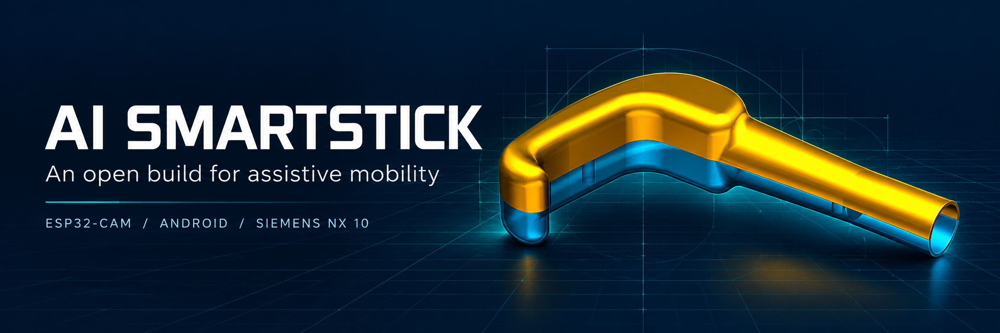
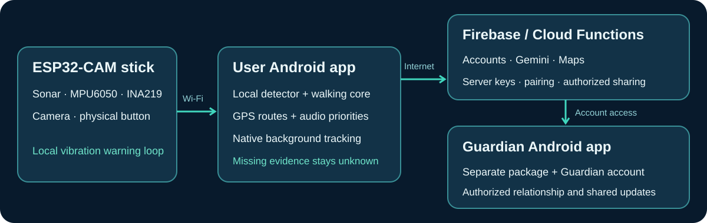
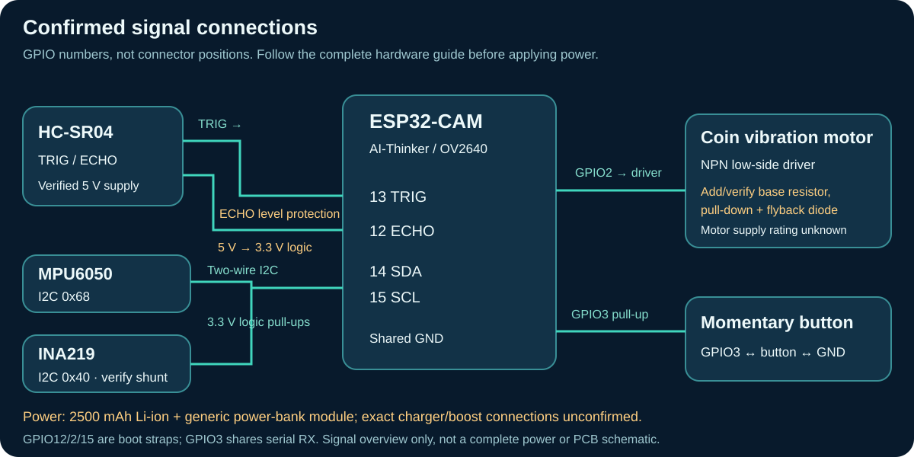

<p align="center"></p>

<p align="center"><a href="docs/BUILD_GUIDE.md"><b>Build guide</b></a> · <a href="docs/HARDWARE.md"><b>Parts & wiring</b></a> · <a href="hardware/README.md"><b>CAD & printing</b></a> · <a href="https://github.com/ParthSancheti/AiSmartStick/releases/tag/v0.2.0-prototype-20261018"><b>Download APKs</b></a></p>

# AI SmartStick

An assistive cane project combining **ESP32-CAM sensors and vibration feedback**, a **stick-user Android app**, and a separate **Guardian app**. The phone adds local perception, walking guidance, Google Maps navigation and Gemini scene/voice assistance. Firebase connects accounts and Guardian sharing. The enclosure was designed in **Siemens NX 10**.

This repository contains the apps, backend, firmware, device-independent walking algorithm, original enclosure CAD, renders and a sanitized historical wiring-test sketch. The banner is an AI-generated illustration based on the supplied enclosure render; the original renders are below.

> **Prototype for supervised testing.** Camera labels can miss obstacles or be incorrect. A single ultrasonic beam and monocular boxes do not establish safe clearance, stairs/drop-offs or crossing safety. Mounting, electrical assembly and field operation need validation. Use your normal mobility aid and a companion during trials.

## Start here

| Your goal | Follow this |
|---|---|
| Install the user app | [AI SmartStick user APK](https://github.com/ParthSancheti/AiSmartStick/releases/download/v0.2.0-prototype-20261018/AI-SmartStick-user.apk) |
| Install the separate Guardian app | [SmartStick Guardian APK](https://github.com/ParthSancheti/AiSmartStick/releases/download/v0.2.0-prototype-20261018/SmartStick-Guardian.apk) |
| Rebuild the whole system | [Beginner build guide](docs/BUILD_GUIDE.md) |
| Buy parts and wire the electronics | [BOM and exact GPIO wiring](docs/HARDWARE.md) |
| Inspect CAD or prepare an enclosure print | [CAD and printing notes](hardware/README.md) |
| Configure cloud services | [Google/Firebase setup](docs/GOOGLE_CLOUD_SETUP.md) and [two-app setup](docs/DUAL_APP_SETUP.md) |
| Test the assembled stick | [Acceptance checks](docs/REAL_DEVICE_ACCEPTANCE.md) and [device debugging](docs/DEVICE_DEBUG.md) |

The APKs are **debug testing builds** connected to the maintainer's backend. Independent builders must configure their own backend, signing fingerprints and API restrictions. Use separate user and Guardian accounts. [Release notes](docs/RELEASE_NOTES.md) · [SHA-256 checksums](https://github.com/ParthSancheti/AiSmartStick/releases/download/v0.2.0-prototype-20261018/SHA256SUMS.txt).

## How it works



1. **The stick** reads ultrasonic distance, MPU6050 motion, INA219 battery/current data and button gestures. Firmware controls local vibration warnings and exposes the device/camera protocol over Wi-Fi.
2. **The user phone** runs EfficientDet-Lite0 detection, sensor conditioning and a deterministic walking reducer. It also handles GPS routes, audio priorities and native background walking tracking.
3. **Cloud Functions** broker Gemini scene interpretation/Live credentials and Maps services. Long-lived server keys stay on the backend.
4. **Guardian** uses its own app identity and an authorized relationship to access shared features.

Real and demo modes use separate state. Missing evidence stays unknown; the real app does not substitute simulated measurements. Cloud assistance needs phone internet while the stick's Wi-Fi has no internet.

## Hardware used

The owner confirmed a **2500 mAh Li-ion battery**, **power-bank module**, **coin vibration motor** and **NPN transistor**. The code identifies an AI-Thinker ESP32-CAM/OV2640, HC-SR04, MPU6050, INA219 and momentary button. Exact cell configuration, module/motor/transistor ratings, shaft dimensions and print settings were not supplied.



| Function | GPIO / address |
|---|---|
| Ultrasonic TRIG / protected ECHO | 13 / 12 |
| Vibration driver control | 2 |
| Button to ground, internal pull-up | 3 |
| I2C SDA / SCL | 14 / 15 |
| MPU6050 / INA219 | `0x68` / `0x40` |

**Read the [full wiring guide](docs/HARDWARE.md) before powering it.** ECHO needs level protection; the motor needs a complete driver/protection circuit. The reported NPN-only build is distinguished from recommended base resistance, pull-down and flyback protection. Charging and supply connections depend on the actual power-bank module.

## Enclosure and original files

| Assembly | Interior |
|---|---|
|  |  |

- [Main_Left.stl](hardware/cad/Main_Left.stl) · [Main_Right.stl](hardware/cad/Main_Right.stl) · [Bin.stl](hardware/cad/Bin.stl)
- [Original NX 10 part](hardware/cad/BLIND%20MANS%20SUPPORT_x_t.prt)
- [CAD bounds, triangle counts and hashes](hardware/cad/manifest.json)

STL does not declare a physical unit. Confirm scale, fit, mounting, fasteners and strength before printing. The `.prt` filename is retained as provided; format conversion and print validation are not claimed.

The [bench-test sketch](hardware/diagnostics/sketch_sep19b/sketch_sep19b.ino) has Wi-Fi credentials replaced by placeholders. It is a **historical standalone diagnostic**, with different endpoints and blocking test logic. Flash [`firmware/ai_smart_stick_v1`](firmware/ai_smart_stick_v1) for the current app.

## Quick software setup

Install the tools specified in the [complete guide](docs/BUILD_GUIDE.md), then:

```powershell
git clone https://github.com/ParthSancheti/AiSmartStick.git
cd AiSmartStick
npm ci
npm --prefix functions ci
Copy-Item .env.example .env
Copy-Item functions/.env.example functions/.env
```

Fill your own configuration and Android Firebase registrations before real builds. **Never put Gemini/server secrets in `VITE_*` variables.**

For a clearly simulated UI demo in PowerShell:

```powershell
$env:VITE_APP_MODE = "demo"
$env:VITE_APP_ROLE = "combined"
npm run dev
```

Clear those shell overrides, then build the roles **sequentially** because they share output folders:

```powershell
Remove-Item Env:VITE_APP_MODE, Env:VITE_APP_ROLE -ErrorAction SilentlyContinue
npm run apk:user
npm run apk:guardian
```

Outputs: `deliverables/AI-SmartStick-user-debug.apk` and `deliverables/AI-SmartStick-guardian-debug.apk`. APK building does not deploy the backend. The guide covers Firebase, Maps/Gemini, App Check, firmware flashing, pairing and first-use checks.

## Source and verification

| Folder | Purpose |
|---|---|
| `src/features/user`, `src/features/guardian` | The two app experiences |
| `src/core/perception` | Device-independent sensor/walking core |
| `src/core/vision`, `src/core/ai`, `src/core/navigation` | Detection, assistance and routes |
| `android` | Native networking, service and walking tracking |
| `firmware/ai_smart_stick_v1` | ESP32-CAM protocol-v1 firmware |
| `functions`, `shared` | Backend and shared contracts/tools |
| `hardware` | NX/STL CAD, renders and diagnostic sketch |
| `tests`, `docs` | Automated checks and rebuild documentation |

```powershell
npm test
npm run typecheck
npm run functions:build
npm run algorithm:build
npm run algorithm:smoke
npm run test:walking-native
```

Recorded validation: **955 app tests across 80 files**, plus **20,000 seeded fault events / 155,268 assertions**. The owner confirmed scene analysis on the installed phone after the server/login fixes. These results do not measure field accuracy or battery life. See [verification](docs/VERIFICATION.md), [algorithm](docs/ALGORITHM.md) and [scene/sign-in fix](docs/SCENE_AND_LOGIN_FIX.md).

References: [cloud setup](docs/GOOGLE_CLOUD_SETUP.md), [two-app architecture](docs/DUAL_APP_SETUP.md), [algorithm](docs/ALGORITHM.md), [firmware audit](firmware/FIRMWARE_AUDIT.md).

Generated builds, personal configuration and private device logs are excluded from Git. Superseded files were moved to a recoverable local backup; see [cleanup notes](docs/CLEANUP.md). Third-party dependencies retain their own licenses. No project-wide redistribution license has been selected.

