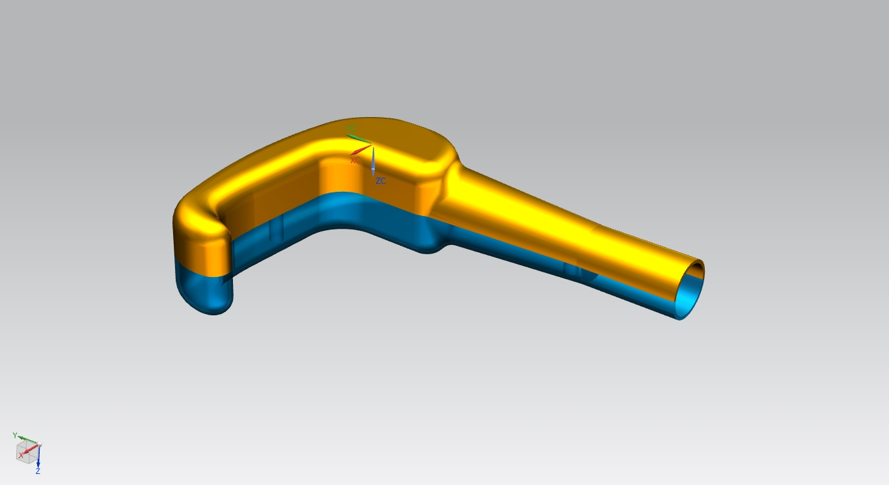
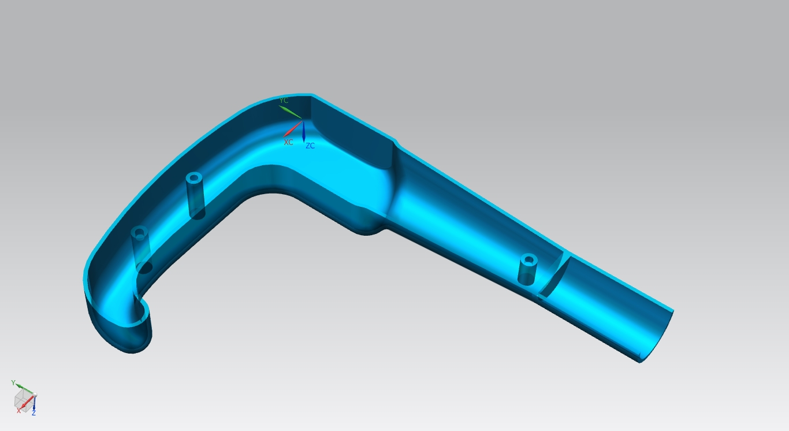

# Enclosure and original hardware assets

The enclosure was designed in **Siemens NX 10**. Fabrication dimensions/settings still need verification.

| File | Purpose |
|---|---|
| [Bin.stl](cad/Bin.stl) | Supplied mesh; confirm its role and fit before printing. |
| [Main_Left.stl](cad/Main_Left.stl) | Supplied left enclosure mesh. |
| [Main_Right.stl](cad/Main_Right.stl) | Supplied right enclosure mesh. |
| [BLIND MANS SUPPORT_x_t.prt](cad/BLIND%20MANS%20SUPPORT_x_t.prt) | Native NX part; do not assume a Parasolid export from its name. |
| [Original diagnostic sketch](diagnostics/sketch_sep19b/sketch_sep19b.ino) | Historical bench dashboard; Wi-Fi credentials replaced with placeholders. |

## Before printing

1. Inspect native dimensions/bodies/shaft interface in NX 10 or a verified compatible installation.
2. Load all STLs into a slicer. Check scale against native CAD and actual components: STL units are unconfirmed.
3. Verify component/cable clearances and unobstructed camera/sonar.
4. Test-print for fit before choosing material, orientation, walls, infill, layer height/supports. No validated recipe was supplied.
5. Confirm shaft/tip dimensions, screws and inserts; renderings cannot establish thread sizes or handle strength.
6. Fit unpowered electronics with insulation, strain relief and service access.

Waterproofing, structural strength and cane function need physical validation.

## Which firmware to use

The historical sketch joins user Wi-Fi and exposes `/data`, `/motor?pattern=…` and `:81/stream`, with blocking motor delays and simple orientation/battery estimates.

**Build the application with [`firmware/ai_smart_stick_v1`](../firmware/ai_smart_stick_v1/), not the historical sketch.** The current firmware owns its Wi-Fi AP and exposes `/api/v1/*` protocol 1 telemetry/commands. The phone expects that contract. Both sketches use the same external signal pins; that does not make their APIs interchangeable.

See [parts/wiring](../docs/HARDWARE.md), [flashing](../docs/FIRMWARE_SETUP.md) and [build instructions](../docs/BUILD_GUIDE.md). Assets are included; personal `D:` paths are unnecessary.
